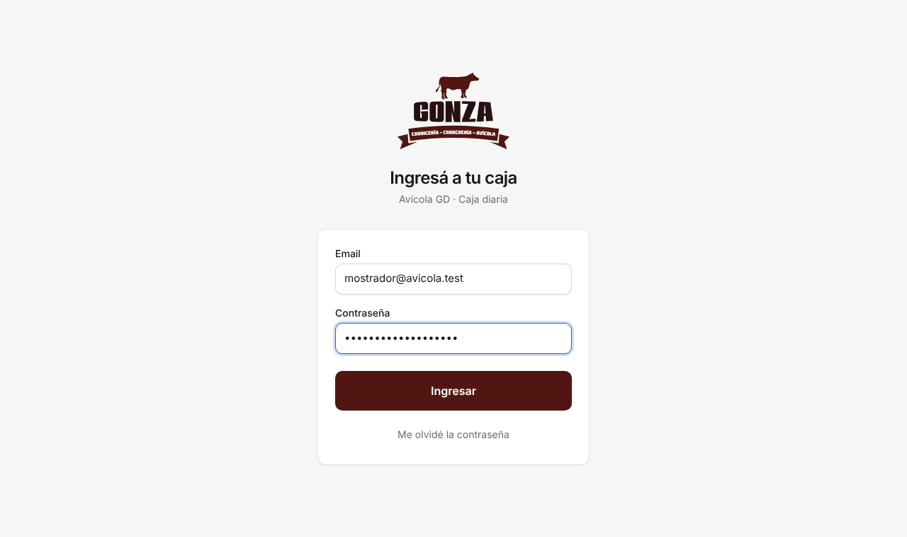
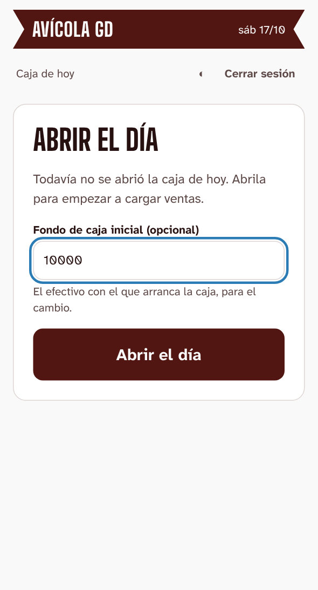
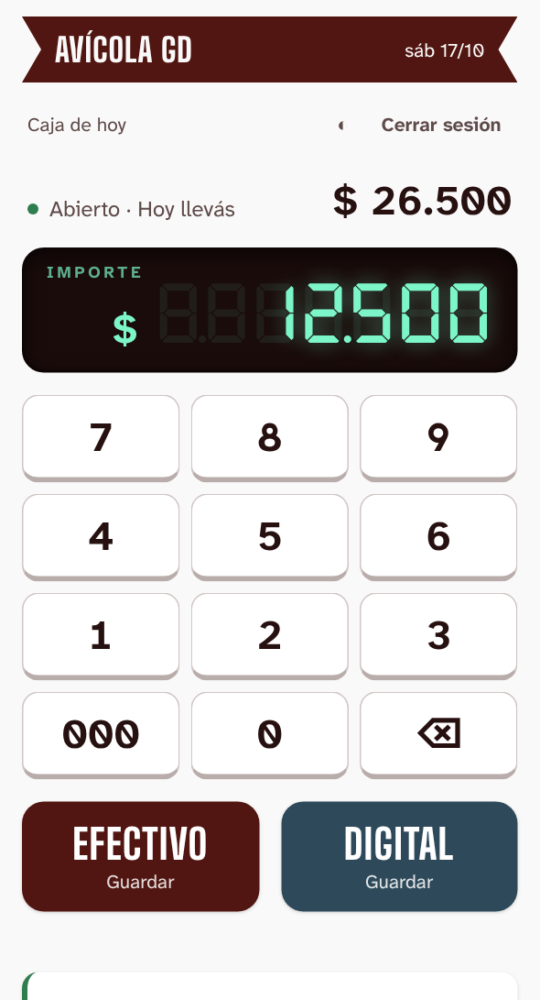
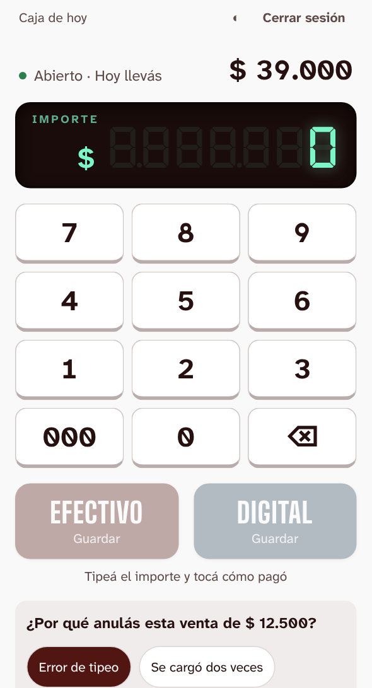
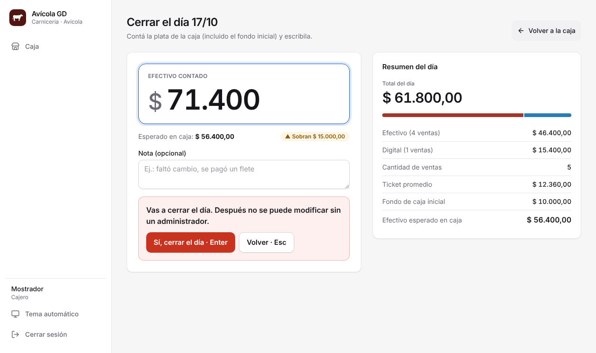
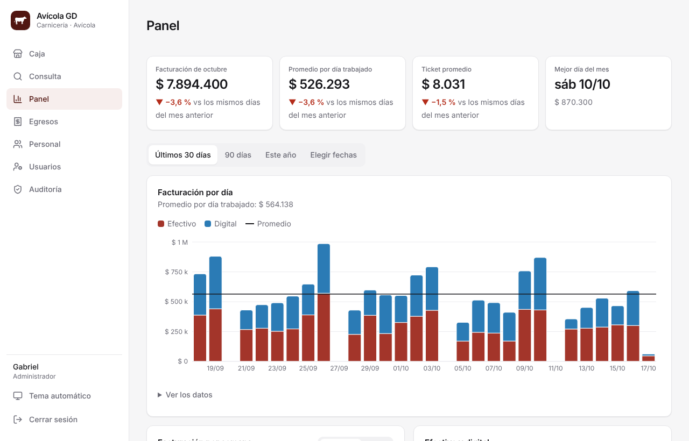

# Guía rápida de Avícola GD

Una página para usar la app todos los días. No hace falta saber de computadoras.

## 1. Entrar

Abrí la app (el ícono de la vaca en la compu o el celular del local). Escribí el usuario (por ejemplo `mostrador`) o tu email, la contraseña, y tocá **Ingresar**.
La sesión queda abierta todo el día; se cierra sola si pasan 12 horas sin usarla.

## 2. Abrir el día (a la mañana)

Si todavía no se abrió la caja, aparece **Abrir el día**. Si arrancás con plata para el cambio, escribila; si no, dejalo en 0. Apretá **Enter**.

## 3. Cargar una venta (con el teclado)

El cursor ya está en el campo **Importe**: no hace falta hacer clic.

1. Escribí el importe con los números del teclado (por ejemplo `12500`).
2. Apretá:
   - **Enter** si pagó en **efectivo**.
   - **+** si fue **digital** (transferencia, tarjeta o Mercado Pago).

Eso guarda la venta. Aparece "✓ Venta guardada" abajo a la derecha, el total sube y el campo queda vacío para la siguiente.
Si te equivocaste, tocá **Deshacer** en ese aviso, o **Anular** en la lista (tenés 10 minutos). **Esc** borra lo que escribiste.
Si una venta es muy grande (más de $ 500.000), la app pregunta si está bien: **Enter** para guardar, **Esc** para corregir.

**Si dice "Sin internet":** la venta **no** se guardó. El importe queda escrito; cuando vuelva la conexión, apretá Enter o + de nuevo.

En el celular también anda: se abre el teclado numérico y tocás **Efectivo** o **Digital**.

## 4. Anular una venta

En la lista de ventas, tocá **Anular**, elegí el motivo (por ejemplo, _Error de tipeo_) y confirmá. La venta no se borra: queda tachada y no suma.
Pasados 10 minutos, solo un administrador puede anularla.

## 5. Pagarle al proveedor o sacar plata de la caja

Si sacás plata del cajón con el día abierto (al proveedor del pollo, para vos, para comprar bolsas), anotalo así el cierre da bien:

1. Apretá **−** (la tecla de restar) o tocá **Sacar efectivo**.
2. Escribí cuánto sacaste y elegí para qué: **Pago a proveedor**, **Retiro del dueño**, **Gasto del local** u **Otro**.
3. Apretá **Enter**.

Esa plata se descuenta de lo que tiene que haber en la caja. El pago a proveedor y el gasto del local quedan también en **Egresos**, así no hay que cargarlos dos veces.

## 6. Cobros de Mercado Pago (entran solos)

Si Mercado Pago está conectado (ver [MERCADO-PAGO.md](MERCADO-PAGO.md)), lo que te pagan con el QR o al alias de Mercado Pago aparece solo en la caja, con un aviso verde: **"Entraron $ 8.000 por Mercado Pago"**. **No hace falta tipearlo.**
Si lo tipeás igual con **+**, la app te pregunta si es otra venta: **Enter** = sí, es otra; **Esc** = no, ya estaba.

## 7. Cerrar el día (a la noche)

1. Tocá **Cerrar el día** (arriba a la derecha).
2. Contá la plata de la caja (incluido el fondo inicial), escribila y apretá **Enter**.
3. La app te dice si **coincide**, si **sobra** o si **falta**. Si no coincide, escribí una nota.
4. Apretá **Enter** otra vez para confirmar (o tocá **Sí, cerrar el día**).

Después de cerrar no se pueden cargar ni cambiar ventas de ese día. Si hay que corregir algo, un administrador puede **reabrirlo** (queda anotado).
Si un día quedó sin cerrar, al otro día la app pide cerrarlo primero.
Cuando cerrás, aparece **Mandar resumen por WhatsApp**: abre WhatsApp con el resumen del día escrito (total, efectivo, digital, Mercado Pago, salidas y si la caja dio bien), listo para mandar.

## 8. Para el dueño (administradores)

En la barra de la izquierda aparecen más secciones:

- **Consulta:** cualquier día, semana o mes, comparado con el período anterior. En el mes está **Descargar PDF para el contador** y **Descargar Excel**.
- **Panel:** gráficos de cómo viene el negocio (por día, por semana, efectivo vs. digital, días y horas en que más se vende, ingresos y gastos) y cómo va hoy contra el mismo día de la semana pasada.
- **Egresos:** cargar lo que se paga (alquiler, mercadería, luz, impuestos). Se anulan con motivo, no se borran.
- **Usuarios:** crear cuentas (con un usuario simple, por ejemplo `mostrador`, sin email), dar una contraseña nueva si alguien se la olvidó y desactivar a quien ya no trabaja. Los datos de entrada se pueden mandar por WhatsApp.
- **Auditoría:** quién anuló, cerró, reabrió o cambió algo, y cuándo.
- **Ajustes:** la conexión con Mercado Pago (y los cobros para revisar), el WhatsApp al que se manda el resumen y el importe a partir del cual la caja pide confirmación.

La **ganancia aproximada** es ventas − egresos cargados en la app (si pagás sueldos, cargalos como egreso). Es una estimación, no un balance contable.

## Si algo no anda

- **No puedo entrar:** revisá el usuario y la contraseña. Si te la olvidaste, pedile al dueño que en **Usuarios** toque _Se olvidó la contraseña_: te da una nueva al instante.
- **Se ve todo raro o viejo:** cerrá la app y abrila de nuevo (se actualiza sola).
- **Para cualquier otra cosa:** avisale a Ezequiel.
